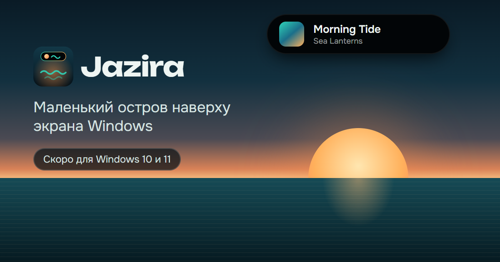

# Jazira — лендинг

[English below ↓](#english)

Сайт приложения **Jazira** — «острова» у верхнего края экрана Windows: музыка, тексты песен,
таймер фокуса, вода, полка файлов, задачи. Пока приложения нет, сайт работает как **лист ожидания**.
Автор — Bilol. Языки: русский, английский, таджикский.

Статический сайт без сборки и без зависимостей: HTML + CSS + JS. Лицензия — [MIT](LICENSE).

**Сайт онлайн: https://boboevproject-rgb.github.io/jazira/**

**Само приложение для Windows** (версия 0.1: музыка, таймер фокуса, вода, уведомления) — в папке
[`app/`](app/README.md): исходники, сборка, установка.



## Скачать и запустить

1. **Скачать.** На странице репозитория: зелёная кнопка **Code → Download ZIP**
   ([прямая ссылка](https://github.com/boboevproject-rgb/jazira/archive/refs/heads/main.zip)), затем распаковать.
   Или через git:
   ```bash
   git clone https://github.com/boboevproject-rgb/jazira.git
   ```
2. **Запустить** — любой способ:
   - **Windows:** дважды щёлкните `start.bat` — откроется http://localhost:8791/.
     Нужен [Python 3.8+](https://www.python.org/downloads/) — если его нет, `start.bat` сам откроет страницу загрузки.
     Ярлык «Jazira» на рабочем столе: дважды щёлкните `create-shortcut.bat`.
   - **Любая система:** `python tools/serve.py` (или `python3 tools/serve.py`) и откройте http://localhost:8791/.
   - **Просто посмотреть:** откройте `index.html` в браузере. Работает всё, кроме отправки форм.
3. **Сделать своим** — см. «Настройки» ниже: название, автор, Telegram, адрес формы — в одном месте.
4. **Обновить** до свежей версии: `git pull` в папке проекта (если скачивали через git) или скачайте ZIP заново.

На локальном сервере заявки из форм сохраняются в `dev-submissions.jsonl` (файл в git не попадает).

## Настройки — один блок

Всё, что меняется при запуске, — в начале [`assets/main.js`](assets/main.js), объект `CONFIG`:

| Поле | Что это |
|---|---|
| `brand`, `author` | название продукта и автор — подставляются во все тексты |
| `formUrl` | адрес Apps Script (`…/exec`) для форм — см. [apps-script/README.md](apps-script/README.md) |
| `downloadUrl`, `version` | когда появится установщик: сайт сам переключится с листа ожидания на «Скачать» |
| `telegram` | ссылка на Telegram — появится в подвале (пусто — ссылки нет) |

Тексты — в [`assets/i18n.js`](assets/i18n.js), иконка — [`assets/icon.svg`](assets/icon.svg)
(PNG и картинка для соцсетей пересобираются командой `python tools/render_assets.py`).

## Структура

```
index.html            разметка; русский текст — запасной для поисковиков и браузеров без JS
assets/style.css      стили (тёмная тема «море и закат»)
assets/i18n.js        все тексты на ru / en / tg
assets/main.js        CONFIG, переводы, демо острова, формы
assets/icon.svg       иконка (исходник), icon-*.png и og.png собираются из него
apps-script/Code.gs   приём форм: Google-таблица + Telegram
tools/                локальный сервер, проверки, сборка картинок
```

## Тексты и переводы

Каждый текст — ключ в `assets/i18n.js` с тремя языками; в HTML элемент помечен `data-t="ключ"`
(атрибуты — `data-t-attr="placeholder:ключ"`). Если правите русский текст, поправьте его и в `index.html`.
Новый язык: добавьте его код в `LANGS` в `main.js`, кнопку в переключатель и перевод в каждый ключ.

Таджикский перевод сделан без носителя языка — перед запуском стоит показать его носителю.

## Проверки

```bash
python tools/check_i18n.py          # все ключи на месте, три языка, таджикский алфавит
node tools/test-apps-script.mjs     # логика приёма форм (без Google)
python tools/test_page.py           # браузер без окна: 3 языка × ПК/телефон, формы, демо; скриншоты в shots/
python tools/render_assets.py       # пересобрать icon-*.png и og.png после правок иконки
```

Для `test_page.py` и `render_assets.py` нужен Playwright (`pip install playwright`) и Chrome или Edge.

## Опубликовать в интернете

Этот репозиторий уже опубликован через GitHub Pages из ветки `main`: каждый пуш обновляет сайт
через минуту-две. Файл `.nojekyll` отключает обработку Jekyll — файлы отдаются как есть.

Своя копия — это обычные статические файлы, подойдёт любой хостинг:

- **GitHub Pages:** Settings → Pages → Source: *Deploy from a branch* → `main` / `(root)`.
  Сайт появится по адресу `https://<ваш-логин>.github.io/jazira/`.
- **Netlify, Cloudflare Pages, свой nginx** — просто выложите папку целиком.

В своей копии замените в `index.html` адрес в `og:url`, `og:image` и `canonical` на свой —
иначе превью в соцсетях будет вести на этот сайт.

## Лицензия

[MIT](LICENSE): код, тексты и графику можно свободно использовать, менять и распространять,
в том числе в коммерческих проектах. Условие одно — сохранить файл `LICENSE` с указанием автора.

---

<a id="english"></a>

## English

**Jazira** is a landing page for a Windows app that turns the top edge of the screen into a small
"island" for music, lyrics, a focus timer, water reminders, a file shelf and tasks. Until the app
ships, the site collects a waitlist. Languages: Russian, English, Tajik. Plain HTML + CSS + JS,
no build step, no dependencies. Licensed under [MIT](LICENSE).

**Live site: https://boboevproject-rgb.github.io/jazira/** · **The Windows app** (v0.1) lives in
[`app/`](app/README.md).

### Quick start

1. **Download** — **Code → Download ZIP** on the repository page
   ([direct link](https://github.com/boboevproject-rgb/jazira/archive/refs/heads/main.zip)), or
   `git clone https://github.com/boboevproject-rgb/jazira.git`.
2. **Run** — on Windows double-click `start.bat` (and `create-shortcut.bat` for a desktop shortcut);
   anywhere else run `python tools/serve.py` (Python 3.8+) and open http://localhost:8791/. To just look
   around, open `index.html` in a browser (everything except form submission works).
3. **Make it yours** — edit the `CONFIG` block at the top of `assets/main.js` (product name, author,
   Telegram link, form URL, download URL). Texts live in `assets/i18n.js`, the icon in `assets/icon.svg`.

### Forms

The waitlist and feedback forms post to a Google Apps Script web app ([`apps-script/Code.gs`](apps-script/Code.gs))
that writes rows to a Google Sheet and can forward each submission to Telegram. Setup steps are in
[`apps-script/README.md`](apps-script/README.md) (in Russian; the flow is: bind the script to a sheet,
set `TG_TOKEN` / `TG_CHAT` script properties, deploy as a web app with access for "Anyone", paste the
`/exec` URL into `CONFIG.formUrl`). On the local server, submissions go to `dev-submissions.jsonl`.

### Deploy

Any static hosting works: GitHub Pages (Settings → Pages → deploy from `main` / root), Netlify,
Cloudflare Pages or your own nginx. In your copy, point `og:url`, `og:image` and `canonical` in
`index.html` at your own address, otherwise social previews will link back to this site.
